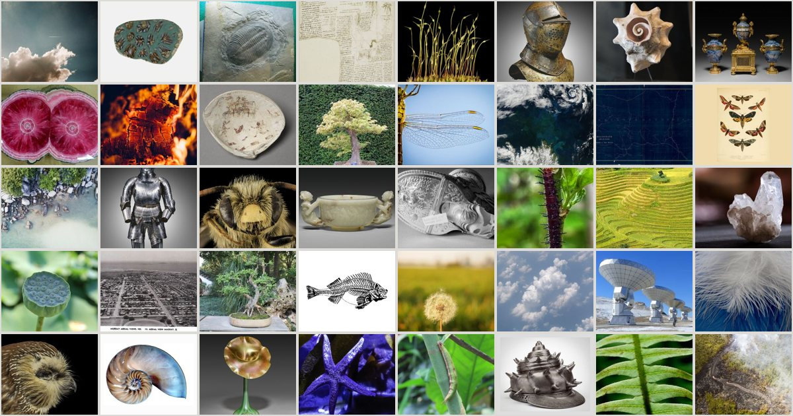

# flash-montage library

989 curated open images of real objects for flash-montage teasers: shells, skeletons, eyes, botanical plates,
minerals, creatures, machines, archive drawings, aerials, the cosmos and studio objects, each a single subject on a
plain ground or a full-bleed texture. Plus 162 stills of the 3D specimens generated by the
[flash-montage](https://github.com/arjunkshah12345-hash/flash-montage) skill.

**Browse:** https://arjunkshah12345-hash.github.io/flash-montage-library/



## Get it

```bash
# with the skill installed
python3 -I ~/.agents/skills/flash-montage/scripts/get_library.py            # all of it (~200 MB)
python3 -I ~/.agents/skills/flash-montage/scripts/get_library.py --only cosmos,botanical

# without the skill
git clone --depth 1 https://github.com/arjunkshah12345-hash/flash-montage-library
```

## Layout

| Path | What |
| --- | --- |
| `assets/library/<category>/*.jpg` | the images, 1600 px on the long side at most |
| `assets/library/<category>/thumbs/` | 320 px thumbnails |
| `assets/library/manifest.jsonl` | one record per image: title, creator, licence, licence URL, source page, provider, width, height, ground (`seamless-light`, `seamless-dark`, `full-bleed`), ground luminance, 4-colour palette, saturation, search query |
| `CREDITS.md` | every image with its creator, licence and source |
| `index.html`, `library.css`, `library.js`, `data/` | the gallery site |

## How it was made

Fetched from Openverse (`license=cc0,pdm`), the NASA Image and Video Library, Wikimedia Commons (public-domain and
CC0 files only) and the Cleveland Museum of Art open-access API (`cc0=1`), by `scripts/fetch_assets.py` in the skill.
1,338 files were fetched; every contact sheet was then reviewed by eye and 338 were rejected (people-centred
pictures, food, toys, documents, near-blank frames, duplicates, baked-in checkerboards). NASA items credited to ESA or
other agencies were left out.

## Licences

Each image keeps its own licence, recorded in `manifest.jsonl` and `CREDITS.md`:

| Licence | Images |
| --- | --- |
| CC0 1.0 | 496 |
| Public Domain Mark / public domain | 211 |
| NASA media (public domain in the US; credit NASA where you can, no endorsement implied) | 118 |
| Generated by flash-montage specimens, dedicated CC0 | 162 |
| Flickr Commons, "no known copyright restrictions" | 2 |

Public-domain status can differ between countries, and photographs of people, trademarks or artworks can carry
rights of their own. Check the source page before relying on an image for something sensitive. The site code
(`index.html`, `library.css`, `library.js`) is MIT. The manifest metadata is CC0.
